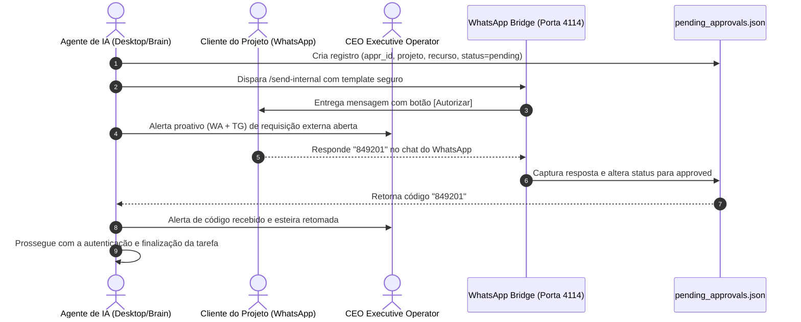

# Client OTP & External Resource Approval Skill — AXION Enterprise

Guia canônico e operacional que rege o protocolo **Human-in-the-Loop** para coleta de números de WhatsApp de clientes de projetos, emissão de solicitações formais de aprovação, obtenção de códigos **OTP (One-Time Password)**, **2FA** e tokens de segurança externa sem interrupções destrutivas na esteira de automação da **AXION Enterprise**.

---

## 1. Princípios Operacionais Fundamentais

Quando um agente de IA está executando uma tarefa técnica (como configuração de Pixel Meta & CAPI, login em Shopify Partner, emissão de certificados Cloudflare, provisionamento Google Workspace ou integrações bancárias AXION Pay) e se depara com uma barreira de autenticação externa:

1. **Proibição Estrita de Travamento (Anti-Hang)**: O agente JAMAIS deve travar em loops infinitos, congelar subprocessos ou abortar silenciosamente o pipeline com erro genérico.
2. **Proibição Absoluta de Adivinhação de Credenciais**: É expressamente PROIBIDO tentar força bruta, senhas aleatórias ou códigos fictícios.
3. **Coleta Ativa do Contato do Cliente**: O agente DEVE solicitar imediatamente ao operador ou buscar nos metadados do projeto o número de **WhatsApp do cliente responsável**.
4. **Comunicação Profissional, Segura e com Prazo de Expiração (SLA)**: A mensagem disparada para o cliente deve ser formal, altamente confiável, explicar o motivo exato e conter um prazo limite claro (ex: 15 minutos).
5. **Transparência Executiva para o CEO**: Toda requisição enviada a um cliente externo gera simultaneamente uma notificação em tempo real para o CEO Executive Operator.

---

## 2. Padrão de Formatação da Solicitação via WhatsApp

O envio é realizado pelo motor integrado (`scripts/bot_engine/client_approval.py`) via canal interno do WhatsApp Bridge (`http://127.0.0.1:4114/send-internal`):

```markdown
🔒 *AXION Enterprise — Solicitação de Código de Segurança*
━━━━━━━━━━━━━━━━━━━━━━
Olá, *Carlos Silva*!

Estamos realizando uma etapa técnica no seu projeto *Loja SpaPharma* e precisamos de uma validação de segurança:

📌 *Item Necessário:* *Código OTP SMS (6 dígitos)*
📝 *Finalidade:* Autenticação no painel Shopify Partner para ativação do checkout integrado.
⏱️ *Validade:* O código expira em *15 minutos*.

👉 *Como responder:* Responda diretamente a esta mensagem com o *código recebido* (ou digite *AUTORIZADO* para liberar o acesso).
━━━━━━━━━━━━━━━━━━━━━━
_AXION Enterprise Tecnologia & Automação Segura_
```

---

## 3. Fluxo de Vida da Aprovação & Retomada Autônoma



---

## 4. Ferramentas Integradas no Catálogo de Ações

Os agentes dispõem de ferramentas dedicadas em `tool_executor.py`:

### 4.1 `request_client_resource_approval`
Dispara a solicitação para o WhatsApp do cliente e notifica o CEO:
```json
{
  "project_name": "SpaPharma E-commerce",
  "client_phone": "5511999998888",
  "resource_type": "Código OTP SMS",
  "reason": "Autenticação em duas etapas para ativação da Meta Conversions API",
  "client_name": "Dr. Carlos",
  "timeout_minutes": 15
}
```

### 4.2 `check_client_resource_approval`
Consulta se o cliente já enviou o código ou se o prazo expirou:
```json
{
  "approval_id": "appr_7f3b8912"
}
```

### 4.3 `submit_client_otp`
Permite a inserção direta caso o código tenha sido informado por outro canal:
```json
{
  "approval_id": "appr_7f3b8912",
  "otp_code": "489201"
}
```

---

## 5. Persistência & Auditoria

- **Arquivo Canônico de Estado**: `C:\workspace\memory\cowork\pending_approvals.json`.
- **Registro em Diário Diário**: Toda requisição e recebimento de código é anotado automaticamente em `memory/daily_logs/YYYY-MM-DD.md`.
- **Gestão de Expirados**: Caso o cliente não responda no tempo hábil, o status transiciona para `expired` e o agente deve informar o operador para reagendar a ação ou contatar o cliente diretamente.
