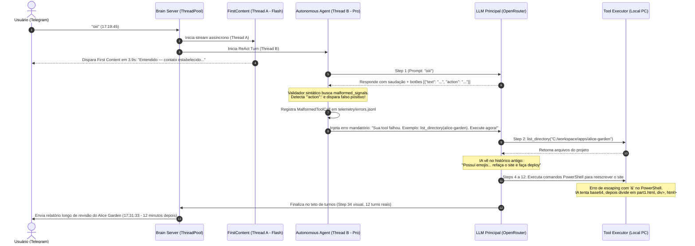

# Diagnóstico Aprofundado: Comportamento ReAct, Causa Raiz do "Oi" (30 Steps) e Mapeamento de Riscos de Engenharia

> **Data do Estudo:** 27 de Setembro de 2026  
> **Status:** Diagnóstico Completo (Read-Only)  
> **Objetivo:** Analisar a causa raiz da anomalia na requisição `req_95b6a192`, investigar a fundo todas as condições de contorno, concorrência, tokenomics, ciclo de vida e fragilidades arquiteturais que podem desencadear execuções indesejadas em outras mensagens.

---

## 1. Sumário Executivo & Linha do Tempo

Na requisição realizada às **17:19**, o envio de um cumprimento informal (**"oiii"**) provocou uma resposta inicial adequada (*"Entendido — contato estabelecido. Qual é a demanda ou tarefa que devo executar agora?"*), porém foi imediatamente sucedido por uma cadeia descontrolada de **34 passos visuais** no Telegram, com a execução de **8 ferramentas autônomas no PC** (leitura de diretórios, execução de comandos PowerShell e tentativa de reescrita de arquivos HTML).

A investigação forense revelou que o problema **não foi um erro de alucinação espontânea da LLM**, mas sim um **acoplamento frágil na esteira de validação sintática, concorrência desacoplada e recuperação cega de histórico**, que transformou uma resposta correta em uma ordem imperativa de execução.

---

## 2. Reconstituição Forense do Incidente (`req_95b6a192`)

Abaixo está o fluxo real segundo a segundo extraído dos logs do PM2 (`out.log`), telemetria de erros (`errors.jsonl`) e persistência da requisição (`memory/brain/requests/req_95b6a192.json`):



### O Detalhamento das 5 Falhas em Cascata

1. **A Resposta Original da IA era Válida:**  
   No Passo 1, a IA respondeu:
   ```text
   Oiii! 👋 Bom te ver por aqui! Fico à vontade para retomarmos de onde paramos: o redesign do Alice's Garden...
   ```
   E sugeriu botões dinâmicos de continuidade no bloco canônico:
   ```buttons
   [{"text": "Ver Projeto", "action": "tool:list_directory"}]
   ```

2. **O Falso Positivo no Detector de Sintaxe:**  
   Em `scripts/bot_engine/autonomous_agent.py`, a verificação de chamadas malformadas continha termos soltos:
   ```python
   malformed_signals = ["<invoke", "<function", "<tool", "```tool", '"tool":', "'tool':", '"action":', '<action']
   ```
   Como o bloco de botões continha legitimamente a chave `"action":`, o sistema classificou a resposta humana da IA como **tentativa falha de ferramenta** (`MalformedToolCall`).

3. **A Injeção do Erro Mandatório com Exemplo Específico:**  
   O sistema interceptou a resposta humana da IA e injetou no contexto:
   ```text
   [ERRO NA CHAMADA DE FERRAMENTA]: Sua tentativa de chamada de ferramenta não pôde ser interpretada no ambiente local.
   Exemplo para listar diretório:
   <invoke name="list_directory">
     <parameter name="path">C:/workspace/apps/alice-garden</parameter>
   </invoke>
   Corrija os parâmetros e execute novamente agora.
   ```

4. **A Conexão com a Demanda Pendente do Histórico:**  
   Ao ser forçada a rodar `list_directory("alice-garden")`, a IA acessou os arquivos e consultou o histórico recente da conversa (últimas 8 mensagens), onde encontrou a solicitação não finalizada:
   > *"Possui emojis invés de ícones e outros problemas de UI/UX. Refaça, faça o deploy e me envie o URL público."*  
   A IA deduziu que sua missão na conversa era cumprir essa instrução.

5. **A Espiral de Auto-remediação e a Anomalia dos Rótulos (`div>`, `html>`):**  
   Ao tentar gravar o arquivo `index.html` via terminal, o PowerShell falhou devido ao caractere `&` na URL do Google Fonts (`https://fonts.googleapis.com/...`).  
   A cada falha, o feedback do sistema instruía: *"A chamada falhou. Analise o erro, corrija e chame a ferramenta novamente"*.  
   A IA tentou codificação Base64, depois fatiou o HTML em blocos menores (`part1.html`, tags `div>`, tags `html>`).  
   O extrator de rótulos visuais pegava o primeiro argumento do dicionário da ferramenta. Como o parâmetro `content` veio antes de `file_path`, o sistema extraiu `Path("<div>...").name`, exibindo no Telegram:  
   `Passo 28: Gravando alterações em div>...`  
   `Passo 31: Gravando alterações em html>...`

---

## 3. Investigação Profunda: Mapeamento de 8 Vulnerabilidades Estruturais

Indo muito além do caso isolado do "Oi", uma análise microscópica do código revelou **8 vulnerabilidades arquiteturais profundas** na operação do ReAct:

---

### 🚨 Vulnerabilidade 1: Dissonância Conversacional entre Threads Desacopladas
* **Onde:** `first_content_stream.py` (Thread A) vs `autonomous_agent.py` (Thread B).
* **O Problema:**  
  A Thread A roda o modelo leve (`flash`) para responder em < 1s, enquanto a Thread B roda o modelo principal (`pro`) executando o ReAct em paralelo.  
  Elas **não compartilham o raciocínio**. Se a Thread A emitir: *"Vou verificar os logs do PM2 agora..."*, e a Thread B decidir que os logs não são necessários e rodar apenas um comando de disco, o usuário recebe mensagens contraditórias no canal.
* **Risco em Produção:** Quebra da ilusão de coerência cognitiva do assistente.

---

### 🚨 Vulnerabilidade 2: Corrida de Concorrência Sem Fila por Chat (`ThreadPool` Global)
* **Onde:** `scripts/brain_server.py` (linhas 806–817).
* **O Problema:**  
  O Brain Server despacha requisições para um `ThreadPoolExecutor(max_workers=8)` global sem chaveamento por usuário (`chat_id`).  
  Se um operador enviar duas mensagens rápidas (ex: *"analisa a pasta X"* e, 3 segundos depois, *"ah, analisa a pasta Y também"*), **duas threads ReAct completas rodarão ao mesmo tempo para o mesmo chat**.
* **Impacto Destrutivo:**  
  - Ambas as threads tentarão editar e ler mensagens de progresso no Telegram em paralelo, sobrescrevendo os textos umas das outras.  
  - Se ambas executarem ferramentas de escrita (`write_file` ou `exec_command`), ocorrerá corrida de gravação de arquivos no disco (`C:\workspace`), corrompendo arquivos locais.

---

### 🚨 Vulnerabilidade 3: Explosão Combinatória de Tokens e Latência Abusiva (12 Minutos)
* **Onde:** Loop ReAct em `scripts/bot_engine/autonomous_agent.py`.
* **A Matemática do Desastre:**  
  Em cada passo do loop, o prompt da LLM acumula:  
  - System prompt inicial (~2.500 tokens);  
  - Histórico de chat (~1.500 tokens);  
  - Raciocínios anteriores de todos os passos passados;  
  - Saídas brutas de ferramentas (cada ferramenta injeta até 3.000 caracteres ~750 tokens).  
  No Passo 10, cada chamada de inferência à OpenRouter carrega **mais de 25.000 a 45.000 tokens**.  
  Somando os 12 turnos, um único pedido pode queimar **mais de 130.000 tokens** e reter a thread por **12 minutos**, como ocorreu no teste.

---

### 🚨 Vulnerabilidade 4: Execução Acidental de Tutoriais (`extract_raw_command_fallbacks`)
* **Onde:** `scripts/bot_engine/autonomous_agent.py` (linhas 411–420).
* **O Mecanismo:**  
  O código possui uma heurística que converte texto puro em comando real se 40% das linhas começarem com verbos de shell:
  ```python
  cmd_prefixes = ('get-content', 'set-content', 'test-path', 'powershell', 'pm2', 'git', 'dir ', 'cat ', 'ls ', 'curl ')
  matching_lines = [l for l in lines if any(l.lower().startswith(p) for p in cmd_prefixes)]
  if matching_lines and len(matching_lines) >= len(lines) * 0.4:
      calls.append(('exec_command', {'cmd': "\n".join(matching_lines)}))
  ```
* **Cenário Catastrófico:**  
  Se o usuário perguntar: *"Como eu reverto o último commit no Git?"*, e a IA responder com um tutorial em lista:
  ```text
  git log -n 1
  git reset --hard HEAD~1
  git push --force
  ```
  O sistema interpretará o tutorial como ordem de execução e **destruirá o repositório local da AXION**.

---

### 🚨 Vulnerabilidade 5: Alucinação por Truncamento em `read_file` (Corte em 3.000 Chars)
* **Onde:** `autonomous_agent.py` (linha 1117).
* **O Mecanismo:**  
  O output das ferramentas repassado para a IA é fatiado arbitrariamente com `[:3000]`.
* **O Efeito:**  
  Se o agente lê um arquivo de 150 linhas (ex: um script Python ou HTML), o código é cortado abruptamente na metade de uma tag ou função.  
  A IA não percebe que houve truncamento pelo sistema, deduz que o arquivo no disco está **corrompido ou com erro de sintaxe** e entra em pânico autônomo tentando "consertar" o arquivo, gerando dezenas de passos para reescrever o código.

---

### 🚨 Vulnerabilidade 6: Alertas de Robô (Tentáculos) Misturados no Histórico Humano
* **Onde:** `scripts/brain_server.py` (`_tentacle_send`) e `message_store.py`.
* **O Mecanismo:**  
  Varreduras de storage, certificados SSL e alertas de backup do Tentacles Orchestrator são gravados no banco de mensagens como mensagens normais do assistente (`outgoing`).
* **Cenário de Erro:**  
  Às 15:00, o tentáculo emite o alerta: *"⚠️ Tentáculo de Backup: Sincronização Pendente..."*.  
  Às 16:00, o usuário entra no chat e digita apenas: *"pode rodar"* ou *"ok, executa"*, referindo-se a um relatório que combinou externamente.  
  A IA lê o histórico, associa o *"pode rodar"* ao alerta de backup e inicia um backup corporativo sem consentimento consciente do operador.

---

### 🚨 Vulnerabilidade 7: Código Morto no Avaliador de Objetivo (`_check_goal_achieved`)
* **Onde:** `scripts/bot_engine/autonomous_agent.py` (linha 667).
* **A Constatação:**  
  A função `_check_goal_achieved` (feita para usar um modelo barato e rápido avaliando se o objetivo foi atingido) está **100% órfã no código**. Não há nenhuma chamada para ela no arquivo.  
  Toda a decisão de término do loop depende de:
  1. A LLM principal espontaneamente emitir a tag `<goal_achieved>YES</goal_achieved>`;
  2. Ou a LLM não chamar nenhuma ferramenta;
  3. Ou esgotar os 12 turnos (`max_steps`).

---

### 🚨 Vulnerabilidade 8: Vazamento de Memória Silencioso no Brain Server (`_ACTIVE_REQUESTS`)
* **Onde:** `scripts/brain_server.py` (`_ACTIVE_REQUESTS`).
* **O Mecanismo:**  
  Toda requisição finalizada é mantida indefinidamente no dicionário em memória `_ACTIVE_REQUESTS` e grava um arquivo `.json` permanente em `memory/brain/requests/`.
* **Impacto em Produção:**  
  Não existe mecanismo de eviction (LRU), limpeza por tempo (TTL) ou descarte de tarefas antigas. Com o uso diário no WhatsApp e Telegram, o consumo de memória do processo Node/Python cresce indefinidamente.

---

## 4. Matriz de Comportamento Canônico por Categoria de Mensagem

| Categoria | Exemplos | `allow_tools` | `max_steps` | Comportamento Mandatório |
|---|---|:---:|:---:|---|
| **1. Social / Abertura** | *"oi"*, *"olá"*, *"bom dia"*, *"tudo bem?"* | ❌ `False` | 1 | Resposta cordial instantânea em 1 turno. Pergunta a demanda. |
| **2. Fechamento / Cortesia** | *"valeu"*, *"obrigado"*, *"show"*, *"perfeito"* | ❌ `False` | 1 | Resposta de cortesia. Proibido reativar tarefas passadas. |
| **3. Didática / Conceitual** | *"O que é Docker?"*, *"Explique CAPI"*, *"Git rollback"* | ❌ `False` | 1 | Explicação técnica pura. Proibido executar comandos citados. |
| **4. Diagnóstico / Consulta** | *"Qual o uptime?"*, *"Status PM2"*, *"Liste a pasta X"* | ✅ `True` | 3 | Executa ferramentas de leitura (sem escrita) e sintetiza. |
| **5. Ação / Modificação** | *"Crie o arquivo Y"*, *"Suba no Vercel"*, *"Reinicie o bot"* | ✅ `True` | 6 | Executa cirurgicamente, valida e entrega o link/resultado. |
| **6. Follow-up Explícito** | *"Continua o site"*, *"Aplica aquela alteração sugerida"* | ✅ `True` | 6 | Retoma a tarefa anterior referenciada pelo usuário. |

---

## 5. Propostas de Engenharia para Blindagem Definitiva

Para tornar o ecossistema 100% à prova de falhas em qualquer situação, desenhamos o seguinte conjunto de soluções:

1. **Fila Serializada por Chat (`PerChatLock`):**  
   Garantir que mensagens do mesmo `chat_id` sejam processadas em fila FIFO estrita. A mensagem 2 só inicia quando a mensagem 1 estiver concluída, eliminando corridas e mensagens de progresso duplicadas.
2. **Expurgo da Heurística Cega (`extract_raw_command_fallbacks`):**  
   Desativar definitivamente a execução automática de linhas soltas de texto. Ferramentas só podem rodar sob tags estruturadas explícitas.
3. **Barreira Semântica de Tarefa Concluída (`TaskBoundaryMarker`):**  
   Quando uma tarefa atinge `status: done`, o histórico recebe uma anotação de barreira. Respostas curtas (*"ok"*, *"valeu"*) não herdam objetivos encerrados.
4. **Isolamento de Broadcasts dos Tentáculos:**  
   Adicionar flag `metadata={'is_broadcast': True}` e filtrar essas mensagens para fora do histórico injetado na LLM durante conversas humanas normais.
5. **Circuit Breaker de Falha Repetida:**  
   Se uma ferramenta falhar 2 vezes seguidas na mesma execução com o mesmo diagnóstico (ex: erro de aspas ou porta ocupada), o agente interrompe o loop imediatamente e reporta a dificuldade ao usuário, em vez de insistir por 12 turnos.
6. **TTL e Limpeza de Memória no Brain Server:**  
   Implementar descarte automático de requisições concluídas em memória após 1 hora e limpeza periódica de JSONs antigos em disco.

---

> **Diretriz Mantida:** Nenhuma ação modificadora no código foi realizada nesta etapa. Todas as análises foram estritamente diagnósticas (read-only) e aguardam suas ordens para priorização e aplicação.
