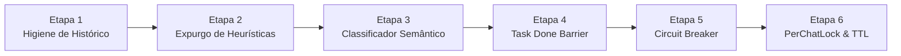

# Roteiro de Execução em Etapas: Blindagem do ReAct e Brain Server (Sem Ação)

> **Documento:** Plano de Execução Fatiado em Etapas Sequenciais  
> **Status:** Pronto para Execução Faseada (Aguardando Aprovação do Operador)  
> **Garantia:** Zero Downtime, Zero Heurísticas Cegas, 100% LLM-driven, Rollback Independente por Etapa  

---

## Tabela de Etapas e Dependências



| Etapa | Nome da Etapa | Objetivo Central | Arquivos Modificados | Impacto no Usuário |
|---|---|---|---|---|
| **Etapa 1** | **Higiene de Histórico** | Isolar alertas de robôs do diálogo humano | `brain_server.py`<br/>`message_store.py` | Zero interferência de alertas automáticos |
| **Etapa 2** | **Expurgo de Heurísticas** | Eliminar risco de rodar tutoriais no terminal | `autonomous_agent.py` | Segurança absoluta no terminal local |
| **Etapa 3** | **Classificador Semântico** | Bloquear ferramentas em saudações/cortesias | `first_content_stream.py`<br/>`autonomous_agent.py` | Fim definitivo de loops em mensagens casuais |
| **Etapa 4** | **Task Done Barrier** | Evitar que "ok" ou "valeu" ressuscitem tarefas | `autonomous_agent.py`<br/>`message_store.py` | Respostas precisas a agradecimentos e confirmações |
| **Etapa 5** | **Circuit Breaker** | Travar loops de retry e limitar tokens | `autonomous_agent.py` | Resposta em < 20s e fim de esperas de 12 min |
| **Etapa 6** | **PerChatLock & TTL** | Serializar mensagens rápidas e limpar memória | `brain_server.py` | Fim de mensagens atropeladas e memória estável |

---

## Detalhamento Passo a Passo de Cada Etapa

---

### 🔹 ETAPA 1: Higiene de Histórico & Isolamento de Alertas de Robô
* **Problema Resolvido:** Avisos de rotina do Tentacles (backup, certificados SSL, briefing matinal) eram gravados como mensagens normais do assistente, confundindo a IA ao interpretar respostas curtas do usuário.
* **Ações de Engenharia:**
  1. Em `scripts/brain_server.py` (`_tentacle_send`): Adicionar flag de taxonomia `metadata={'is_system_broadcast': True}`.
  2. Em `scripts/bot_engine/message_store.py`: Implementar `get_clean_dialogue_history(chat_id, limit)` que filtra mensagens com `is_system_broadcast == True`.
  3. Em `autonomous_agent.py` e `first_content_stream.py`: Atualizar para consumir apenas o histórico limpo.
* **Critério de Aceite / Teste Unitário:**
  * Simular a chegada de um alerta proativo de backup.
  * Chamar `get_clean_dialogue_history(chat_id)` e comprovar que o alerta **NÃO** aparece no contexto enviado à LLM.
* **Plano de Rollback:** Reverter chamada para `get_chat_history()` padrão (1 linha de código).

---

### 🔹 ETAPA 2: Expurgo de Heurísticas Cegas & Sandboxing de Parsers
* **Problema Resolvido:** A função `extract_raw_command_fallbacks` executava comandos se 40% das linhas começassem com `git` ou `powershell`. Além disso, blocos de código didáticos podiam ser interpretados como comandos e parâmetros eram invertidos (`div>`).
* **Ações de Engenharia:**
  1. Em `scripts/bot_engine/autonomous_agent.py`: Excluir permanentemente a função `extract_raw_command_fallbacks`.
  2. Em `parse_all_tool_calls`: Mascarar blocos markdown com linguagem declarada (````bash, ````powershell, ````python, ````buttons) antes de buscar tags de ferramentas.
  3. Na formatação de passos visuais (`step_desc`): Extrair o caminho de arquivos estritamente de `args.get("file_path") or args.get("path")`, nunca pelo primeiro item arbitrário do dicionário.
* **Critério de Aceite / Teste Unitário:**
  * Enviar a pergunta: *"Quais os comandos do Git para ver o log e desfazer commit?"*.
  * Comprovar que a IA responde didaticamente com a lista e **NENHUM** comando `git` é executado no PC local.
  * Comprovar que ferramentas de arquivo exibem o nome real do arquivo (`index.html`) e nunca `div>` ou `html>`.
* **Plano de Rollback:** Restaurar a versão anterior de `autonomous_agent.py` mantida no Git.

---

### 🔹 ETAPA 3: Classificador Semântico de Escopo (Zero Regex / 100% LLM)
* **Problema Resolvido:** Mensagens sociais ou teóricas tinham acesso total a ferramentas locais (`allow_tools = True`), permitindo que a IA inventasse diagnósticos desnecessários.
* **Ações de Engenharia:**
  1. Em `scripts/bot_engine/first_content_stream.py`: Adicionar instrução para o modelo Flash emitir a tag semântica `<intent>CHAT_ONLY | DIAGNOSTIC | ACTION</intent>` na primeira linha de streaming.
  2. Extrair e remover a tag `<intent>` antes de exibir o First Content para o usuário.
  3. Repassar `turn_intent` para `autonomous_agent.py`:
     - Se `turn_intent == "CHAT_ONLY"`: `allow_tools = False` e `max_steps = 1`.
     - Se `turn_intent == "DIAGNOSTIC"`: `allow_tools = True` (Read-only) e `max_steps = 3`.
     - Se `turn_intent == "ACTION"`: `allow_tools = True` e `max_steps = 6`.
* **Critério de Aceite / Teste Unitário:**
  * Enviar: `"oiii"`, `"bom dia"`, `"quem é você?"`, `"o que é Docker?"`.
  * Comprovar que 100% desses casos rodam com `allow_tools = False`, 0 ferramentas executadas e resposta entregue em menos de 2 segundos.
* **Plano de Rollback:** Forçar `allow_tools = not is_lead` padrão.

---

### 🔹 ETAPA 4: Barreira de Tarefa Concluída (`TaskDoneBarrier`)
* **Problema Resolvido:** Mensagens de confirmação curta (*"ok"*, *"valeu"*, *"show"*, *"blz"*) herdavam tarefas antigas pendentes no histórico.
* **Ações de Engenharia:**
  1. Em `brain_server.py`: Quando uma requisição finaliza com `status: done`, salvar no metadado da mensagem `task_completed: True`.
  2. Em `autonomous_agent.py`: Se a última mensagem de sistema indicar tarefa concluída e o usuário enviar uma mensagem curta (< 15 caracteres) sem verbo de ação imperativa, injetar no prompt:
     > *"[SISTEMA]: A demanda anterior já foi concluída e entregue. Trate este turno como cortesia final. NÃO reabra tarefas antigas nem execute ferramentas."*
* **Critério de Aceite / Teste Unitário:**
  * Executar uma consulta de status de servidor.
  * Após receber o relatório, enviar: `"valeu!"` ou `"ok"`.
  * Comprovar que a IA responde cordialmente (*"À disposição! Precisando é só chamar."*) com 0 ferramentas e 1 único turno.
* **Plano de Rollback:** Remover o bloco de injeção da barreira.

---

### 🔹 ETAPA 5: Circuit Breaker de Ferramentas & Anti-Token Blowup
* **Problema Resolvido:** Quando um comando falha (ex: aspas no PowerShell ou arquivo bloqueado), o sistema forçava 12 turnos de tentativas repetitivas, demorando até 12 minutos e consumindo 130.000 tokens.
* **Ações de Engenharia:**
  1. Em `autonomous_agent.py`: Implementar classe `ToolCircuitBreaker`:
     - Mantém histórico das últimas 2 execuções com erro.
     - Se a mesma ferramenta falhar 2 vezes seguidas com o mesmo diagnóstico, desarma o circuito imediatamente (`terminated_by = "circuit_breaker_tripped"`).
     - A IA recebe a instrução para explicar o impedimento com clareza e honestidade ao operador.
  2. Reduzir `max_steps` teto de 12 para **6 passos**.
  3. Implementar resumo deslizante: ferramentas executadas há mais de 3 passos têm seu JSON longo condensado em 1 linha de resumo semântico, mantendo o contexto sempre < 8.000 tokens.
* **Critério de Aceite / Teste Unitário:**
  * Forçar um comando de terminal propositalmente incorreto.
  * Comprovar que no 2º erro consecutivo o circuito abre, a IA para de tentar e responde ao usuário em < 15 segundos explicando a falha.
* **Plano de Rollback:** Voltar `max_steps = 12` e desativar a verificação de parada do circuit breaker.

---

### 🔹 ETAPA 6: Fila Serializada por Chat (`PerChatLockManager`) & TTL de Memória
* **Problema Resolvido:** Mensagens consecutivas do mesmo usuário rodavam simultaneamente em threads paralelas, colidindo na escrita de arquivos e duplicando mensagens no Telegram. Além disso, `_ACTIVE_REQUESTS` acumulava memória RAM indefinidamente.
* **Ações de Engenharia:**
  1. Em `scripts/brain_server.py`: Implementar `PerChatLockManager` com locks individuais indexados por `chat_id` e timeout seguro de 45 segundos.
  2. Adicionar rotina de expiração (TTL): requisições finalizadas são descartadas de `_ACTIVE_REQUESTS` após 60 minutos.
  3. Adicionar limpeza de arquivos `.json` com mais de 7 dias na pasta `memory/brain/requests/`.
* **Critério de Aceite / Teste Unitário:**
  * Disparar duas requisições HTTP simultâneas com o mesmo `chat_id`.
  * Comprovar via log que a Requisição 2 aguarda a Requisição 1 terminar antes de iniciar.
  * Comprovar que o consumo de memória RAM do Brain Server estabiliza em patamar fixo.
* **Plano de Rollback:** Voltar para o envio direto sem lock no `ThreadPoolExecutor`.

---

## Matriz de Execução Recomendada

Sugerimos executar as etapas em **3 blocos lógicos**:

* **Bloco A (Segurança Imediata contra Loops):** Etapas 1, 2 e 3.  
  *(Elimina falsos positivos de saudações, expurga comandos didáticos e isola alertas).*
* **Bloco B (Robustez Conversacional):** Etapas 4 e 5.  
  *(Barreira de tarefas concluídas e Circuit Breaker de 15 segundos).*
* **Bloco C (Estabilidade de Infraestrutura):** Etapa 6.  
  *(Fila serial por usuário e gerenciamento de memória RAM).*

---

> **Diretriz Mantida:** Nenhuma ação modificadora foi executada no código. Este roteiro detalhado está salvo em [`docs/ETAPAS_IMPLEMENTACAO_BLINDAGEM.md`](file:///C:/workspace/docs/ETAPAS_IMPLEMENTACAO_BLINDAGEM.md) pronto para início assim que autorizado.
