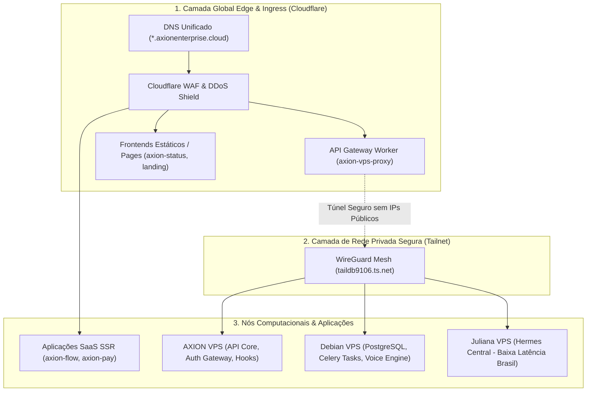

# Plano de Unificação da Arquitetura Híbrida (Vercel, Cloudflare & VPS)

> **Documento Estratégico de Arquitetura**: AXION Unified Fabric  
> **Status**: Proposto & Pronto para Implementação em Fases  
> **Data**: 2026-09-25  

---

## 1. Diagnóstico do Cenário Atual (Arquitetura Fragmentada)

Atualmente, o ecossistema AXION opera de forma distribuída em 4 camadas independentes:
1. **Frontends Híbridos**: 12 projetos na Vercel + 5 projetos no Cloudflare Pages.
2. **APIs & Microserviços**: 15 Cloudflare Workers na borda + microsserviços Node/Python nos VPS.
3. **Servidores & Nós**: 2 VPS Vultr nos EUA com Traefik/Postgres + 1 VPS dedicado no Brasil com Nginx/Hermes Central.
4. **Rede & DNS**: 124 subdomínios em `*.axionenterprise.cloud` com misturas de CNAME Vercel, Proxied Cloudflare e IPs diretos.

### Riscos e Gargalos da Fragmentação:
- **Portas Públicas Expostas**: O VPS principal (`104.207.90.167`) expõe portas de roteador (8080/Traefik) diretamente na internet aberta.
- **Latência Desnecessária**: Chamadas entre Vercel (EUA), Cloudflare Workers (Edge Global) e VPS (EUA/Brasil) sem rota canônica privada.
- **Dificuldade de Autenticação Unificada**: Tokens de sessão e CORS precisam ser autorizados individualmente para dezenas de origens diferentes.

---

## 2. A Arquitetura Alvo: *AXION Unified Fabric*

A unificação proposta estabelece **3 camadas bem definidas**:

---

## 3. As 4 Etapas de Implementação

### Etapa 1: Fechamento de Portas Públicas nos VPS (Zero Public Attack Surface)
* **Ação**: Utilizar o **Cloudflare Tunnel (`cloudflared`)** ou a **Tailnet** para encaminhar tráfego aos VPS.
* **Benefício**: As portas `80`, `443` e `8080` do `axion-vps` e `debian-vps` não precisam mais ficar expostas na internet aberta. Todo o tráfego passará pelo WAF e proteção DDoS do Cloudflare.

### Etapa 2: Padronização de Frontends
* **Aplicações Críticas / SSR**: Manter na Vercel (`axion-flow`, `axion-pay`, `vercel-ai-gateway-demo`) aproveitando React Server Components (Next.js 15).
* **Landing Pages e Sites Institucionais**: Consolidar no Cloudflare Pages (`landing-page-teste-w-solucoes`, `proxion-hub`, `axion-landing`), reduzindo custos com tráfego e garantindo CDN global ilimitada.

### Etapa 3: Roteamento de Voz para o Nó Brasileiro de 7ms
* **Ação**: Direcionar o endpoint `voice.axionenterprise.cloud` e o bridge do WhatsApp (`axion-comm`) para rodar em container Docker no nó `juliana-vps` (100.81.231.111).
* **Benefício**: Redução do delay de áudio e WebRTC de ~200ms para **7ms**, transformando a experiência do cliente final em tempo real.

### Etapa 4: Gateway de Autenticação Unificado (SSO / JWT)
* **Ação**: Centralizar a emissão e validação de tokens JWT no serviço `auth.axionenterprise.cloud`.
* **Benefício**: Um único login permite que o usuário navegue entre o `painel-axion`, `axion-flow` e ferramentas internas sem reautenticação.
