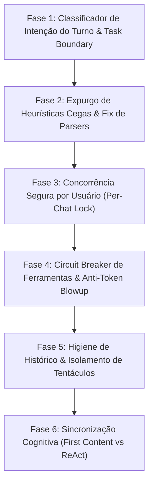

# Plano de Correção e Blindagem Arquitetural do ReAct (Sem Ação)

> **Status:** Documento de Planejamento (Aguardando Aprovação para Execução)  
> **Escopo:** Blindagem definitiva do motor autônomo ReAct, concorrência no Brain Server, higiene de histórico e eliminação de loops e execuções acidentais.

---

## 1. Visão Geral das Fases de Implementação

O plano está estruturado em **6 fases modulares e independentes**, projetadas para serem executadas sem interromper a operação dos canais ativos (WhatsApp e Telegram):



---

## 2. Detalhamento Técnico por Fase

### Fase 1: Classificador de Intenção do Turno & Barreira de Tarefa Concluída
* **Objetivo:** Garantir que mensagens conversacionais (saudações, agradecimentos, dúvidas teóricas) nunca disparem ferramentas ou loops ReAct.
* **Componentes afetados:** `scripts/bot_engine/autonomous_agent.py`.
* **Ações Técnicas:**
  1. Implementar a função `classify_turn_intent(prompt: str, history: list) -> str`:
     - `CHAT_ONLY`: Saudações (*"oi"*, *"bom dia"*), cortesias (*"valeu"*, *"obrigado"*, *"show"*) e perguntas conceituais sem menção a arquivos ou servidores.
     - `DIAGNOSTIC`: Consultas e inspeções (*"uptime"*, *"status do PM2"*, *"verifique o diretório X"*).
     - `ACTION`: Ordens de modificação (*"crie"*, *"altere"*, *"faça deploy"*, *"reinicie"*).
  2. Regra de ouro: Se `intent == "CHAT_ONLY"`, fixar compulsoriamente `allow_tools = False` e `max_steps = 1`. A IA responderá em um único turno humano sem acesso ao terminal.
  3. Adicionar o `TaskBoundaryMarker`: Ao concluir uma requisição com sucesso (`status: done`), injetar no histórico um delimitador de tarefa concluída. Respostas curtas (*"ok"*, *"blz"*) em turnos seguintes não herdarão a meta da tarefa encerrada.

---

### Fase 2: Expurgo de Heurísticas Cegas & Correção de Parsers
* **Objetivo:** Eliminar qualquer possibilidade de o sistema executar comandos de terminal acidentalmente ou quebrar na extração de parâmetros.
* **Componentes afetados:** `scripts/bot_engine/autonomous_agent.py`.
* **Ações Técnicas:**
  1. **Remoção de `extract_raw_command_fallbacks`:** Eliminar o trecho de código que verifica se 40% das linhas começam com `git`, `powershell`, etc. Ferramentas só serão executadas sob tags canônicas explícitas (`<invoke>` ou ````tool_call````). Tutoriais e exemplos didáticos jamais serão executados.
  2. **Isolamento de blocos nos parsers:** Garantir que blocos de código com linguagem declarada (```markdown, ```json, ```html, ```buttons) sejam ignorados pelo extrator de XML de ferramentas.
  3. **Correção dos rótulos de passos visuais (`step_desc`):**  
     Para ferramentas de arquivo (`write_file`, `replace_in_file`), extrair o nome do arquivo estritamente pela chave `tool_args.get("file_path")`, e nunca pelo primeiro valor arbitrário do dicionário. Isso elimina anomalias visuais como *"Gravando alterações em div>..."*.

---

### Fase 3: Concorrência Segura por Usuário (`PerChatLock`)
* **Objetivo:** Impedir que o mesmo usuário dispare múltiplas execuções concorrentes que colidam no Telegram e no disco rígido.
* **Componentes afetados:** `scripts/brain_server.py`.
* **Ações Técnicas:**
  1. Implementar o gerenciador `_CHAT_LOCKS = {}` com `threading.Lock()` individualizado por `chat_id`.
  2. Quando uma mensagem chega no endpoint `/v1/chat`, ela obtém o lock correspondente àquele `chat_id`:
     - Mensagem 1 processa normalmente.
     - Se o usuário enviar a Mensagem 2 antes da conclusão da Mensagem 1, a Mensagem 2 aguarda a finalização de forma serializada, ou é enfileirada sem duplicar mensagens de progresso.
  3. Elimina a possibilidade de dois loops ReAct gravarem simultaneamente em pastas locais (`C:\workspace`).

---

### Fase 4: Circuit Breaker de Ferramentas & Controle de Custo/Tokens
* **Objetivo:** Impedir espirais de 12 minutos e acúmulo descontrolado de tokens quando uma ferramenta falhar.
* **Componentes afetados:** `scripts/bot_engine/autonomous_agent.py`.
* **Ações Técnicas:**
  1. **Implementar Circuit Breaker de Repetição:**  
     Adicionar um dicionário de falhas consecutivas:  
     `tool_failures = {tool_name: count}`.  
     Se a mesma ferramenta falhar 2 vezes seguidas com o mesmo diagnóstico de erro, o ReAct loop é interrompido imediatamente. A IA sintetiza o impedimento com transparência e entrega ao usuário, em vez de insistir por 10 turnos.
  2. **Redução do Teto Máximo de Turnos (`max_steps`):**  
     Reduzir o teto de 12 turnos para **6 turnos**. Se uma tarefa legítima exigir mais de 6 turnos, ela deve ser decomposta ou solicitar confirmação ao operador.
  3. **Janela Deslizante de Feedback:**  
     Limitar o histórico acumulado de ferramentas para manter a chamada da LLM sempre abaixo de 10.000 tokens por turno, mantendo a latência e o consumo sob controle rigoroso.

---

### Fase 5: Higiene de Histórico & Isolamento dos Tentáculos
* **Objetivo:** Impedir que mensagens automáticas de rotina dos robôs interfiram nas respostas às mensagens humanas.
* **Componentes afetados:** `scripts/brain_server.py` e `scripts/bot_engine/message_store.py`.
* **Ações Técnicas:**
  1. **Flag de Broadcast nos Tentáculos:**  
     Ao emitir avisos de backup, telemetria matinal ou checagens SSL, marcar o registro com `metadata={'is_system_broadcast': True}`.
  2. **Filtro de Histórico:**  
     Na função `message_store.get_chat_history(chat_id)`, ignorar mensagens com `is_system_broadcast == True`. A IA receberá apenas a linha pura do diálogo entre o humano e o assistente.
  3. **TTL de Requisições no Brain Server:**  
     Implementar um coletor que remove requisições finalizadas de `_ACTIVE_REQUESTS` após 60 minutos, mantendo a memória RAM estável ao longo do tempo.

---

### Fase 6: Sincronização Cognitiva (First Content vs ReAct)
* **Objetivo:** Evitar discrepâncias entre o que o First Content promete em < 1s e o que o ReAct executa.
* **Componentes afetados:** `scripts/bot_engine/first_content_stream.py`.
* **Ações Técnicas:**
  1. Adequar as diretrizes do First Content para saudações e mensagens informais: quando o usuário apenas cumprimentar, o First Content deve emitir uma saudação amigável e direta, sem prometer ações ou diagnósticos de ferramentas.
  2. Manter a premissa de First Content 100% LLM, sem regras estáticas, porém orientando o modelo Flash sobre os limites de escopo de cada canal.

---

## 3. Matriz de Testes e Critérios de Aceite

| # | Caso de Teste | Entrada do Usuário | Resultado Esperado | Critério de Aceite |
|---|---|---|---|---|
| **T1** | Saudação Casual | `"oiii"` ou `"bom dia"` | Resposta em 1 turno, 0 ferramentas | Latência < 1.5s, 0 steps de ferramentas, sem ReAct loop. |
| **T2** | Cortesia / Fechamento | `"valeu"`, `"obrigado"`, `"show"` | Resposta em 1 turno, 0 ferramentas | Não reativa tarefas anteriores do histórico. |
| **T3** | Dúvida Didática | *"Como reverto um commit no git?"* | Explicação didática em texto | NENHUM comando `git` é executado no host real. |
| **T4** | Diagnóstico Legítimo | *"Qual o uptime e uso de RAM?"* | Executa telemetria e sintetiza | Executa ferramentas de leitura, emite passos claros e conclui em < 5s. |
| **T5** | Mensagens Concorrentes | 2 mensagens enviadas em 2 segundos | Processadas serialmente pelo lock | 0 mensagens duplicadas no Telegram, sem corrida no disco. |
| **T6** | Falha de Ferramenta | Comando inexistente ou porta bloqueada | Circuit breaker aciona no 2º erro | Encerra com relatório honesto sem consumir 12 turnos. |

---

## 4. Estratégia de Rollout Seguro

1. **Testes Unitários em Ambiente Isolado:**  
   Validação de cada função com scripts de teste sem envio para clientes reais.
2. **Deploy Sem Downtime:**  
   Aplicação fase por fase no Brain Server e reload via PM2 (`pm2 reload axion-brain-server`).
3. **Auditoria de Logs em Tempo Real:**  
   Monitoramento do PM2 e da telemetria (`errors.jsonl`) após a ativação de cada fase para garantir zero regressões.

---

> **Aviso de Conformidade:** Nenhuma modificação de código foi realizada. Este plano permanece como proposta técnica para revisão e validação prévia.
