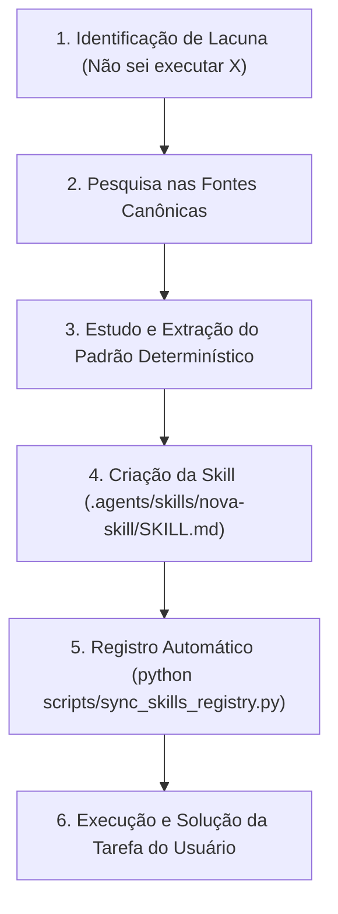

# Guia Canônico de Fontes de Skills & Protocolo de Aprendizado Ativo

> **Destinação**: Documento de governança e instrução canônica para todos os agentes de IA, IDEs assistidas e desenvolvedores no ecossistema **AXION Enterprise**.  
> **Status**: Mandatório e Permanente.

---

## 1. Diretiva Central: Princípio de Pesquisa e Aprendizado Ativo

> [!IMPORTANT]
> **PROIBIÇÃO ESTRITA DE IMPROVISO E ADIVINHAÇÃO (Zero Guesswork Protocol)**  
> Sempre que qualquer agente de IA se deparar com uma tarefa, ferramenta, biblioteca, API ou desafio técnico que **não saiba exatamente como executar** (ou que não possua uma skill local correspondente), é **terminantemente PROIBIDO**:
> 1. Tentar "adivinhar" parâmetros, comandos e flags de CLI.
> 2. Implementar soluções improvisadas sem embasamento em padrões oficiais.
> 3. Declarar que uma funcionalidade é impossível sem consulta prévia às fontes especializadas.

---

## 2. O Ciclo Canônico em 5 Passos (Research -> Learn -> Scaffold -> Register -> Apply)

Sempre que surgir uma nova demanda ou lacuna de conhecimento, o agente DEVE executar rigorosamente o seguinte ciclo:



### Passo 1: Pesquisa Especializada
Consulte as fontes canônicas abaixo usando ferramentas de busca na web (`search_web`) ou inspeção direta de repositórios do ecossistema de agentes.

### Passo 2: Estudo de Boas Práticas
Leia as regras, exemplos de código, arquivos `.cursorrules` ou `SKILL.md` das fontes consultadas para entender a sintaxe moderna (ex: versões mais recentes das libs, tratamento de erros, tipagem estrita).

### Passo 3: Criação da Nova Skill Operacional
Crie o diretório em `.agents/skills/<nome-da-skill>/` contendo:
- `SKILL.md`: Com frontmatter YAML (`name`, `description`), contexto, comandos e padrões de código.
- `references/` (opcional): Cheatsheets e tabelas de comandos.
- `scripts/` (opcional): Scripts utilitários em Python/PowerShell/Bash.

### Passo 4: Registro e Sincronização Automática
Execute imediatamente o registrador no terminal:
```powershell
python scripts/sync_skills_registry.py
```
Isso atualizará instantaneamente a matriz do [AGENTS.md](file:///C:/workspace/AGENTS.md), o catálogo [docs/SKILLS_REGISTRY.md](file:///C:/workspace/docs/SKILLS_REGISTRY.md) e o [workspace/inventory.json](file:///C:/workspace/workspace/inventory.json).

### Passo 5: Aplicação da Skill
Execute a solicitação do usuário aplicando a nova skill com rigor técnico, validação empírica e testes de sucesso.

---

## 3. As Melhores Fontes Canônicas para Pesquisa e Importação

Ao pesquisar novas skills, utilize prioritariamente este índice categorizado:

### 3.1 Repositórios Globais de Skills de Agentes
* **VoltAgent / awesome-agent-skills**:
  - *URL*: `https://github.com/VoltAgent/awesome-agent-skills`
  - *Foco*: +1.000 skills prontas no formato aberto `SKILL.md`, categorizadas por stacks (React, Python, Go, Docker, Cloud, Rust, etc.).
* **Anthropics / skills**:
  - *URL*: `https://github.com/anthropics/skills`
  - *Foco*: Padrões oficiais criados e testados pela Anthropic para Claude Code e agentes autônomos.
* **Tech Leads Club / agent-skills**:
  - *URL*: `https://github.com/tech-leads-club/agent-skills`
  - *Foco*: Skills corporativas auditadas para segurança, hardening, pipelines CI/CD e governança.
* **Agent Skill Index / Open Skills**:
  - *URL*: `https://mdskills.ai` / `https://agentskillindex.com` / `https://openskills.cc`
  - *Foco*: Diretório aberto com indexação de skills e verificação de esquemas.

### 3.2 Protocolo MCP (Model Context Protocol) & Conectores Vivos
* **Model Context Protocol Official Servers**:
  - *URL*: `https://github.com/modelcontextprotocol/servers`
  - *Foco*: Servidores MCP oficiais para conexão com PostgreSQL, SQLite, GitHub, GitLab, Google Drive, Slack, Filesystem, Puppeteer.
* **Awesome MCP Servers**:
  - *URL*: `https://github.com/punkpeye/awesome-mcp-servers`
  - *Foco*: O maior catálogo comunitário de servidores MCP do mundo para qualquer API ou serviço de terceiros.

### 3.3 Regras de IDE, Frameworks e Design Patterns (.cursorrules)
* **Cursor Directory**:
  - *URL*: `https://cursor.directory`
  - *Foco*: Milhares de regras e system prompts específicos para Next.js 15, Tailwind v4, FastAPI, NestJS, Flutter, SwiftUI, Three.js, etc.
* **Awesome Cursorrules**:
  - *URL*: `https://github.com/PatrickJS/awesome-cursorrules`
  - *Foco*: Repositório open-source com regras mantidas por mantenedores de frameworks populares.

### 3.4 Ferramentas e Portais Oficiais dos Desenvolvedores
* **Meta for Developers**: `https://developers.facebook.com/docs/` e Meta MCP `https://mcp.facebook.com/devtools`
* **Google Cloud & Workspace**: `https://cloud.google.com/docs` e GAM Wiki `https://github.com/GAM-team/GAM/wiki`
* **Cloudflare Developer Docs**: `https://developers.cloudflare.com/workers/`
* **Three.js Manual & Examples**: `https://threejs.org/docs/` e `https://r3f.docs.pmnd.rs/`
* **OWASP Foundation**: `https://owasp.org/www-project-top-ten/`

---

## 4. Estrutura Padrão Canônica de um Arquivo `SKILL.md`

Todo novo `SKILL.md` gerado pelo agente deve seguir estritamente este esqueleto:

```markdown
---
name: nome-da-skill-em-kebab-case
description: >-
  Descrição em terceira pessoa indicando claramente O QUE a skill faz e EM QUAIS SITUAÇÕES
  o agente deve ativá-la e utilizá-la.
---

# Nome da Skill em Título

Breve contextualização de arquitetura e escopo.

## 1. Contexto & Dependências
- Ferramentas, CLIs e versões exigidas.
- Arquivos de configuração relacionados no workspace.

## 2. Padrões de Código e Comandos Canônicos
- Exemplos reais, testáveis e com tipagem estrita.

## 3. Diretrizes de Segurança & Erros Comuns
- O que NUNCA fazer ao lidar com essa tecnologia.
- Como tratar falhas comuns e diagnósticos rápidos.
```
