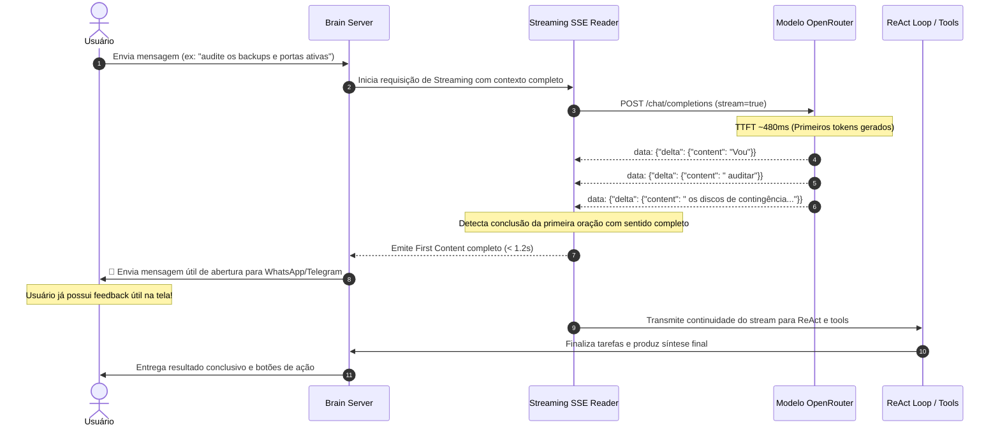

# 01 — Arquitetura e Conceito: First Content Streaming 100% LLM

---

## 1. O Problema da UX Atual

Hoje, quando um operador ou lead envia uma mensagem complexa:
- **No WhatsApp:** O usuário aguarda 10 a 20 segundos em silêncio absoluto (com indicador de digitação intermitente), sem saber se o robô entendeu o escopo, se travou ou o que pretende fazer.
- **No Telegram:** O robô envia uma mensagem mecânica estática (`⚙️ Agente iniciado — analisando seu pedido...`), que soa robótica e desprovida de inteligência contextual.

---

## 2. O Paradigma "Codex / Modern Agentic UX"

No ambiente do Codex, a interação ocorre em dois momentos coordenados:
1. **O Primeiro Conteúdo (Sub-segundo):**  
   Imediatamente após a entrada, o modelo gera uma confirmação substantiva, inteligente e útil demonstrando entendimento do escopo específico (ex: *"Vou estruturar um consolidado de produto e um plano executável com marcos, dependências, validações e rollback..."*).
2. **A Execução em Background:**  
   As etapas reais de inspeção, chamada de ferramentas e síntese acontecem enquanto o usuário já está engajado lendo a confirmação contextual.

---

## 3. O Fluxo de Dados e Tokens

---

## 4. Por Que Banir Heurísticas e Regex?

1. **Infinidade Combinatória:**  
   Não existe mapeamento estático capaz de cobrir perguntas como *"por que o banco de dados falhou após o deploy da porta 4114?"*, *"qual o custo de 5 instâncias de chip?"* ou *"explique a CAPI para o diretor de marketing"*.
2. **Falsos Positivos e Desconexão:**  
   Frases pré-fabricadas soam falsas e frequentemente erram o tom da conversa (ex: dizer *"Vou verificar os arquivos"* para uma pergunta que era puramente teórica ou comercial).
3. **Poder do Modelo:**  
   O modelo `xiaomi/mimo-v2.6-flash` possui capacidade semântica para entender nuances, gírias, termos técnicos e formular a introdução exata com TTFT de 480ms.
